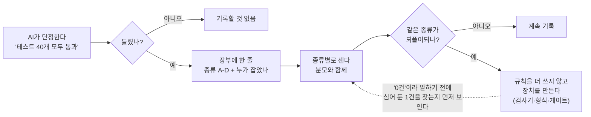
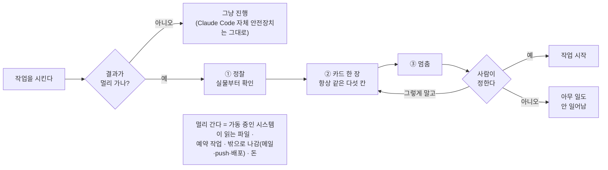

# collab-os

**AI가 틀린 말을 할 때 잡아내는 법.**

*[English](README.md)*

이 문서는 Anthropic 의 터미널 어시스턴트 Claude Code 를 이미 쓰는 분을 위한 것입니다. 아직 없다면 먼저 설치하고 로그인하세요 — Claude Code 공식 문서는 code.claude.com/docs 에 있습니다 — 그 뒤 여기로 돌아오세요.

요즘 AI 어시스턴트는 실수가 잘 티 나지 않을 만큼 똑똑해졌습니다. 엉뚱한 말을 하는 게 아니라 "테스트 40개 전부 통과했습니다", "그 파일은 어디서도 안 씁니다", "사본 두 개 다 고쳤습니다"처럼 매끄럽고 그럴듯하게, 그리고 가끔 틀리게 말합니다. 매일 함께 일한다면 가장 비싼 실수는 **자신 있게 말한 실수**입니다.

collab-os 는 한 사람이 그런 실수를 9주 동안 모아 둔 장부(항목은 어시스턴트가 적었습니다)와, 그 기록을 가능하게 한 최소한의 도구(Claude Code 기준)입니다. 프레임워크가 아닙니다. 전부 한 가지 생각 위에 서 있습니다.

> **확인할 수 있다는 걸 보여 주지 않은 주장은 믿지 않는다.**

## 세 줄로

- **문제:** AI 어시스턴트는 틀린 말을 자신 있게 하고, 되돌릴 수 없는 일을 묻지 않고 합니다.
- **이것은:** 한 사람의 9주치 장부 — AI 어시스턴트가 한 틀린 주장 230건을 사후에 하나씩 적고 누가 잡았는지 분류한 기록 — 와, 그 기록을 가능하게 한 최소한의 도구(헌장 하나, 착수 게이트, 검사기 둘).
- **이것이 아닌 것:** AI 가 읽어 주기를 바라는 규칙 파일. 각 조각은 건너뛴 단계를 보이게 하거나, 실수를 세거나, 검사기 자신을 먼저 검사합니다.



템플릿은 AI 가 읽어 주기를 바라는 글입니다. 이 묶음은 읽어 준다고 가정하지 않습니다 — 건너뛴 단계를 보이게 하고, 놓친 것을 세고, 자기 검사기를 먼저 검사합니다. 그리고 9주치 숫자가 붙어 있습니다.

사례집([`CASES.md`](CASES.md)) → 장부 템플릿([`ledger/LEDGER-TEMPLATE.md`](ledger/LEDGER-TEMPLATE.md)) → 그다음 시작판(약 15분)([`QUICKSTART.md`](QUICKSTART.md)) 순서로 읽으세요.

## Claude Code 에 붙여넣어 설치

macOS + Claude Code 2.1.296 에서 시험했습니다. Linux·Windows 는 다릅니다 — Linux 는 훅과 도구만 확인했고(Claude Code 설치는 미시험), Windows 는 시험하지 않았습니다. 시작 훅은 POSIX 셸 스크립트이고, Windows 에서 Claude Code 는 셸 형식 command 훅을 Git Bash(Git for Windows)로 돌립니다 — Git Bash 가 없으면 PowerShell 로 가는데 이 스크립트는 거기서 돌지 않습니다. WSL 은 시험하지 않았습니다.

압축을 풀고(또는 저장소를 clone 하고) 그 폴더나 바로 위 폴더에서 Claude Code 를 연 뒤, 아래 상자 전체를 대화창에 붙여넣습니다.

<details>
<summary>설치 프롬프트 — 눌러서 펼친 뒤 상자 전체를 복사</summary>

````text
내가 압축을 푼 폴더에서 collab-os 플러그인을 설치해 줘. 아래 단계를 순서대로 하고, 단계마다 결과를 한 줄로 알려 줘.

이 작업 전체의 규칙:
- 쓰는 곳은 collab-os 폴더, ~/.config/collab-os/, 그리고 `claude plugin` 명령이 스스로 쓰는 것뿐이다: ~/.claude/plugins/, ~/.claude/settings.json 의 extraKnownMarketplaces·enabledPlugins 항목, Claude Code 자체 상태 파일 ~/.claude.json(과 ~/.claude/backups/ 아래 백업). Claude Code 자체 파일(settings.json, .claude.json)은 직접 고치지 않는다. 그 밖에는 아무것도 쓰지 않는다.
- rm 금지, sudo 금지, 이미 있는 파일 덮어쓰기 금지, 네트워크 요청 금지.
- 애매하거나 단계가 실패하면 추측하지 말고 멈춰서 나에게 묻는다.

1. 압축을 푼 collab-os 폴더의 절대경로를 찾는다. 현재 폴더, 그 하위 폴더, 상위 폴더에서 collab-os/plugin/.claude-plugin/marketplace.json 을 찾는다(현재 폴더가 바로 collab-os 폴더일 수도 있다). 정확히 하나를 찾지 못하면 나에게 경로를 묻고 멈춘다.
2. `claude plugin marketplace list` 를 먼저 실행한다. 목록에 collab-os 라는 마켓플레이스가 이미 있고 바로 이 폴더를 가리키면 그냥 계속한다. 다른 곳을 가리키면 두 경로를 보여 주고 바꿀지 묻는다 — 내가 「예」라고 할 때만 `claude plugin marketplace remove collab-os` 를 실행하되, 그 전에 이 명령이 거기서 설치된 플러그인도 함께 지우고 그 플러그인의 저장 옵션·비밀·데이터도 삭제한다는 것을 알려 준다. 어느 쪽이든 그다음 `claude plugin marketplace add <그 절대경로>/plugin` → `claude plugin install collab-os@collab-os` → `claude plugin list` 를 차례로 실행한다. 목록에 collab-os@collab-os 와 Status: ✔ enabled 가 함께 보이지 않으면 출력을 그대로 보여 주고 멈춘다.
3. ~/.config/collab-os/CHARTER.md 가 이미 있으면 건드리지 말고 어떻게 할지 묻고 멈춘다. 없으면 `mkdir -p ~/.config/collab-os` 를 실행하고, BEGIN 과 END 사이의 글을 그대로 담은 ~/.config/collab-os/CHARTER.md 를 만든다.
BEGIN
# My charter

## I2. Reality is the source of truth
The actual state beats documents, memory and guesses - meaning what the running
code path really reads. If you cannot check, do not assert.

## I3. No completion without verification
"Done" only after running and checking the real thing. Irreversible or structural
changes get a second pair of eyes that did not share the context that produced them.

## I4. Irreversible things belong to the human
Anything whose effect reaches people, money, live services or running systems
happens only after my approval. Without approval, the default is "don't".
Editing a file that a running process reads is a deployment.

## I8. Start from purpose
Decide what "finished" means before choosing a tool or a method. Purpose is the
reference point for the whole task: changing track is allowed, drifting without
knowing is not - a change of track is a declared decision. Finished means the
purpose is met, not that an artifact exists.
END
4. 이렇게 안내한다: "이 세션을 끝내고 터미널에서 claude 를 다시 실행하세요. 새 세션에서 'what did the collab-os hook tell you?' 라고 물어보세요. 어시스턴트가 헌장 위치를 답하면 된 것입니다."
5. 새 세션에서 게이트를 써 볼 예시 작업 하나를 제안하고 — 예: `/collab-os:gate set up a nightly job that emails me a disk-usage report` — 멈춘다. 그 작업을 실제로 하지는 않는다.
````

</details>

이 프롬프트가 하는 일 전부는 아래 「직접 하려면」과 같습니다 — 먼저 읽어 보고, 어시스턴트에게 맡기기 싫으면 손으로 하세요.

외부 시험자 한 명이 이 붙여넣기 설치를 끝까지 마쳤습니다(이전 판에서 2단계에서 한 번 멈췄고, 고쳤습니다). 걸리는 시간은 아직 재지 않았습니다 — 멈추면 어디서 멈췄는지 알려 주세요.

## 실측

| | |
|---|---|
| 기간 | 한 사용자의 틀린 주장 장부, 2026-08-21 → 2026-10-23 (63일 — 9주, 2026-10-23 10:24 `tools/ledger_count.py claims --profile private` 로 집계, 사용자 자신의 이름을 `human` 으로 잇는 `--alias` 하나 추가) |
| 기록된 틀린 주장 | 번호 붙은 항목 230건(12b 처럼 접미가 붙은 번호도 한 항목) — A 32 · B 60 · C 100 · D 38 (A 인용 대체 · B 깨진 측정 · C 전수 미조회 — 일부만 보고 전체를 단정 · D 기타 — 정의는 `ledger/LEDGER-TEMPLATE.md`) |
| 「항목」의 정의 | 날짜·번호·계급이 있는 머리줄. 접미 번호(12b, 161-a)는 별도 항목이고, 후보·철회 표시 머리줄은 제외합니다. 순수 번호만 세면 216입니다. 번호 없는 머리줄(4)은 세지 않습니다 |
| 누가 잡았나 | 항목마다 탐지자 칸을 `ledger/CODEBOOK.md` 3a 절의 네 단어에 맞춰 분류: 어시스턴트 자신 102 (44%) · 두 번째 모델의 독립 검토 75 (33%) · 사람 22 (10%) · 실행 중 측정 14 (6%) · 분류 불가 17 (7%) — 합계 230 |
| 장부가 생기기 전 | 소급 수집한 21건 중 어시스턴트 자신이 잡은 것 4건. **위 행과 비교 불가** — 장부가 없던 때 변경·결정 기록에 우연히 남은 것만 나중에 뽑은 것이라 소급분 전체가 과소집계이고(자기 발견이 더 많이 빠졌을 가능성은 있으나 미측정), 「틀리면 즉시 등재」라는 장부 규칙 자체가 자기 발견 범주를 만든다 |
| 두 번째 모델 교차검증 | 2026-09-30 → 2026-10-23 판정 카드·코드·문서에 대한 독립 교차검증 47회(장부 51행 중 교차검증으로 끝나지 않은 4행 — 안 돌림 1·안 보냄 1·조언 의뢰 1·뒤에 무효 판정된 읽기 1 — 은 세지 않음), 재확인 뒤 기각한 지적: 2026-10-23 기준 기록 1건 |

**이것은 통제 실험이 아니라 집계이며, 행들은 전·후 비교가 아닙니다.** 장부는 무엇이 잡히는지뿐 아니라 무엇이 눈에 띄고 기록되는지도 바꿉니다. 장부 덕에 어시스턴트가 자기 오류를 더 잡게 됐다는 것은 여기서 보여 주지 않습니다.

## 무엇이 다른가

**기계 쪽 주장 검사는 이미 있습니다.** `lc198707/anti-lie`(스스로를 "LLM Claim Auditing Layer"라고 소개합니다) 같은 도구와 비슷한 프로젝트들은 주장이 나오는 순간 기계가 그 주장을 판정합니다. 주장이 만들어질 때 감사하는 방식입니다.

**행동 게이트도 이미 있습니다.** 되돌릴 수 없는 행동을 막는 훅·게이트도 있습니다 — 예를 들어 `Myr-Aya/GouvernAI-claude-code-plugin`(Claude Code 용 런타임 가드레일)이 있고, Claude Code 용 거버넌스 훅도 점점 늘고 있습니다. 이 저장소의 `/collab-os:gate` 명령도 같은 범주에 속합니다. 시작판에서 처음 써 보는 것일 뿐, 이 프로젝트의 핵심은 아닙니다.

**우리가 찾지 못한 것**은 *사후에* 적는 장부(항목은 어시스턴트가 적는다 — 누가 잡았든)입니다 — 항목마다 탐지자(어시스턴트 자신 / 두 번째 모델 / 사람 / 실행 중 측정)를 분류하고, 모든 "0" 앞에 음성 대조군을 두고, 9주치 숫자를 공개한 것. 2026-10-13 에 이웃한 프로젝트 7개(주장 감사기·거버넌스 훅·사람 승인 게이트)를 GitHub 에서 찾아봤고, 6개는 찾고 1개는 찾지 못했습니다. 찾은 6개 중 이 넷을 모두 갖춘 것은 없었습니다 — 탐지자를 분류한 곳은 0개, 음성 대조군은 2개에 있었고, 장부를 확인할 수 있었던 5개 중 사후 장부를 둔 곳은 0개였습니다(1개는 미확인). 아는 것이 있으면 이슈로 알려 주세요.

차이는 더 똑똑한 검사기가 아닙니다. 기록입니다.

## 들어 있는 것

| 구성 | 무엇인가 | 시작 파일 |
|---|---|---|
| 사례집 | 이 장치들이 실제로 무엇을 잡았는지, 익명으로 짧게 | [`CASES.md`](CASES.md) |
| 틀린 주장 장부 | AI가 틀린 주장을 종류별(A~D)로 적는 양식 + **음성 대조군** 규칙(여기서는 '0' 주장에 대한 대조: 심은 양성 — 같은 명령이 반드시 찾아야 하는 것) | [`ledger/LEDGER-TEMPLATE.md`](ledger/LEDGER-TEMPLATE.md) |
| 뿌리 원인 분류표 | 뿌리 원인 10개(R1~R10)와 판정 순서 — 서로 모르는 두 분류자가 "왜"에 합의할 수 있게 | [`ledger/CODEBOOK.md`](ledger/CODEBOOK.md) |
| 도구 | `tools/claim_scan.py` — 숫자를 말할 때 범위도 함께 말하는지 재는 온도계 / `tools/rule_health.py` — 죽은 포인터·번호 구멍·규칙 개수 변화 / `tools/_config.py` — 경로를 아는 유일한 곳 / `tools/ledger_count.py` — 장부·게이트 장부·사례집을 계급·탐지자별로 분모와 함께 셈 / `tools/negative_control.py` — "0건"을 보고하기 전에 임시 사본에 심은 1건을 먼저 찾게 함 | [`tools/`](tools/) |
| 헌장 템플릿 | 조항 10개 — 조항마다 "이게 없으면 무슨 사고가 나는가" | [`CHARTER-TEMPLATE.md`](CHARTER-TEMPLATE.md) (영어) |
| Claude Code 플러그인 | `/collab-os:gate`(위험한 작업 전에 판정 카드), `/collab-os:recon`(단정하기 전에 실물 확인), `/collab-os:handoff`(세션·모델을 옮길 때 맥락을 잃지 않게) + 세션 시작 훅 | [`plugin/collab-os/README.md`](plugin/collab-os/README.md) |
| 시작판 | 원칙 4개와 명령 1개 — 첫 게이트까지 약 15분 | [`QUICKSTART.md`](QUICKSTART.md) (영어) |
| 공개용 도구 | 이 저장소 자체를 내보낼 때 쓰는 허용 목록 내보내기·단어 하한 유출 검사기 | [`export/`](export/) |

## 모든 것을 떠받치는 네 가지

1. **실물이 정본이다.** README 에서 베낀 숫자는 측정이 아니라 인용이다. "실물"이란 보기에 맞아 보이는 파일이 아니라 **실제로 도는 코드가 읽는 것**이다.
2. **검증 없는 완료는 없다.** "끝났다"는 실행해서 확인했다는 뜻이다. 되돌리기 어렵거나 구조를 바꾸는 변경은 **그걸 만든 맥락을 공유하지 않은 다른 눈**이 본다.
3. **되돌릴 수 없는 일은 사람이 정한다.** 사람·돈·가동 중인 시스템에 닿는 일은 승인을 기다린다. 승인이 없으면 기본값은 "안 한다".
4. **목적에서 시작한다.** 도구나 방법을 고르기 전에 "끝"이 무엇인지 정한다. 방향을 바꾸는 것은 허용되지만 모르는 채 흘러가는 것은 안 된다 — 방향 전환은 **선언된 결정**이다.

헌장의 나머지 여섯 조항 — 산출물은 파일로, 사람의 이해가 병목, 품질 기준선과 가장 싼 경로, 쌓기보다 정제, 규칙은 사람이 만든다, "끝"은 무엇이 바뀌었는지로 — 은 이 네 가지에서 자라 나온 것입니다. 설치 프롬프트가 만드는 시작판 헌장에는 이 넷이 들어 있고, 열 조항 전체는 `CHARTER-TEMPLATE.md` 에 있습니다.

## 왜 틀린 주장을 장부에 적나

대부분의 안전장치는 산출물을 지킵니다. 테스트, 린터, 타입 검사. 그런데 우리가 실제로 결정을 내리는 근거는 AI의 **문장**이고, 문장을 지키는 장치는 거의 없습니다. 틀린 주장을 종류별로 하나씩 적으면 "또 저러네"가 **숫자**가 되고, 숫자가 있어야 "규칙을 더 쓰지 말고 장치를 만들 때"를 알 수 있습니다.

장부에서 가장 쓸모 있는 규칙 하나는 **음성 대조군**입니다. "0건"이라고 말하기 전에, 같은 명령이 일부러 심어 둔 1건을 잡는 걸 먼저 보입니다. 심어 둔 바늘도 못 찾는 검색은 건초 더미가 비었다는 증거가 못 됩니다.

## 설치

Claude Code 가 설치돼 있고 **로그인된** 상태여야 합니다(시작 전에 `claude` 를 한 번 실행해 로그인하세요).

1. **가장 쉬운 방법:** 이 페이지 맨 위 [Claude Code 에 붙여넣어 설치](#claude-code-에-붙여넣어-설치) 의 프롬프트를 Claude Code 에 붙여넣습니다.
2. **확인** — 아래 「설치됐는지 10초 안에 확인하기」(손으로 설치했다면 먼저 아래 「그다음 헌장 만들기」 상자), 그다음 「설치 확인 — 새 세션 열기」와 「`/collab-os:gate` 시험」까지 차례로.
3. **직접 하려면**([`QUICKSTART.md`](QUICKSTART.md) 에 영어로 모든 단계가 있습니다) 압축을 풀고(또는 이 저장소를 `collab-os` 폴더로 clone 하고 — 주소는 GitHub 의 초록색 Code 버튼이 보여 줍니다), `cd collab-os` 로 그 폴더에 들어간 뒤:

```
claude plugin marketplace add ./plugin
claude plugin install collab-os@collab-os
```

(`collab-os` 의 *바로 위* 폴더에서 한다면 첫 명령은 `claude plugin marketplace add ./collab-os/plugin` 입니다.)

**설치됐는지 10초 안에 확인하기** — 터미널에서 `claude plugin list` 를 실행합니다.
- 성공: 목록에 `collab-os@collab-os` 와 `Status: ✔ enabled` 가 보입니다.
- `` No plugins installed. Use `claude plugin install` to install a plugin. `` — 설치 단계가 실행되지 않았습니다.
- `✘ Path does not exist: .../collab-os/plugin`(마켓플레이스 단계에서 나옴) — 다른 폴더에서 실행했습니다. `collab-os` 폴더 안에서 실행하세요(바로 위 폴더에서 할 때는 `./collab-os/plugin` 형을 씁니다).
- `✘ Failed to install plugin "collab-os@collab-os": Plugin "collab-os" not found in marketplace "collab-os".` — 마켓플레이스 단계를 건너뛰었거나 실패했습니다. 그것부터 실행하세요.

**그다음 헌장 만들기** — 플러그인은 설정 파일이 달리 말하지 않으면 `~/.config/collab-os/CHARTER.md` 를 찾습니다. **아래 상자 전체가 명령 하나입니다. 터미널에 통째로 붙여넣으세요**(헌장 글을 손으로 옮기는 게 아닙니다). 그 경로에 헌장이 이미 있으면 건드리지 않고 그렇다고 말합니다.

```
if [ -e ~/.config/collab-os/CHARTER.md ]; then
  echo "CHARTER.md already exists - not touching it"
else
  mkdir -p ~/.config/collab-os && cat > ~/.config/collab-os/CHARTER.md <<'EOF'
# My charter

## I2. Reality is the source of truth
The actual state beats documents, memory and guesses - meaning what the running
code path really reads. If you cannot check, do not assert.

## I3. No completion without verification
"Done" only after running and checking the real thing. Irreversible or structural
changes get a second pair of eyes that did not share the context that produced them.

## I4. Irreversible things belong to the human
Anything whose effect reaches people, money, live services or running systems
happens only after my approval. Without approval, the default is "don't".
Editing a file that a running process reads is a deployment.

## I8. Start from purpose
Decide what "finished" means before choosing a tool or a method. Purpose is the
reference point for the whole task: changing track is allowed, drifting without
knowing is not - a change of track is a declared decision. Finished means the
purpose is met, not that an artifact exists.
EOF
fi
```

열 조항을 다 쓰고 싶으면 `collab-os` 폴더 안에서 — 헌장이 아직 없으면 `mkdir -p ~/.config/collab-os && cp CHARTER-TEMPLATE.md ~/.config/collab-os/CHARTER.md`, 시작판 헌장이 이미 있으면 `cp ~/.config/collab-os/CHARTER.md ~/.config/collab-os/CHARTER-starter-$(date +%Y%m%d-%H%M%S).md && cp CHARTER-TEMPLATE.md ~/.config/collab-os/CHARTER.md`(옛 헌장을 먼저 시각이 붙은 이름으로 복사하므로 템플릿을 못 찾아도 지금 헌장은 그대로 남습니다. 다른 초에 만든 사본은 모두 남고, 같은 초에 다시 실행하면 그 초의 사본을 덮습니다). 헌장을 다른 곳에 두려면 `~/.config/collab-os/config.json` 을 만들어 위치를 알려 줍니다(내용은 [`collab-os.config.example.json`](collab-os.config.example.json) 참고). 훅 안내문을 한국어로 보려면 설정에 `"lang": "ko"` 를 넣습니다.

파이썬 도구는 Python 3.9 이상만 있으면 됩니다. 다른 설치는 없습니다.

### 설치 확인 — 새 세션 열기 (1분)

아무 프로젝트에서 Claude Code 를 새로 엽니다(지금 세션을 끝내고 터미널에서 `claude` 를 다시 실행). 세션 시작 훅이 세션 맥락에 짧은 안내문을 넣습니다. "collab-os 훅이 뭐라고 했어?" 라고 물으면 보여 줍니다. 이런 줄이 들어 있습니다:

```
[collab-os] no config file - using built-in defaults
[collab-os] Charter location announced. Its text is NOT loaded yet - open it yourself when a rule decision comes up.
```

첫 줄은 설정 파일이 없을 때만 나오며, 이 시작판에서는 정상입니다. 설정에 `"lang": "ko"` 를 넣었다면 같은 내용이 한국어로 나옵니다. 대신 `Charter not found` 가 보이면 헌장 파일이 훅이 찾은 경로에 없다는 뜻입니다 — 안내문이 시도한 경로를 함께 찍습니다.

### `/collab-os:gate` 시험 — 진짜 작업 하나로 (3분)

돌고 있는 무언가에 닿는 작업을 하나 고릅니다. 예:

```
/collab-os:gate 매일 아침 디스크 사용량을 메일로 보내는 예약 작업을 등록해 줘
```

이렇게 돼야 합니다:

1. **정찰 먼저** — 무엇을 확인했고(기존 예약 작업, 기존 스크립트, 메일을 어떻게 보낼지) 무엇을 확인하지 못했는지 보고합니다.
2. **카드 한 장, 다섯 칸** — 목적, 산출물, 지평, 어디서 할지, 읽어야 할 정본. 예약 발송이라 되돌리기 줄도 나와야 합니다. 이 다섯 칸과 순서는 gate 스킬이 정해 둔 것입니다. 시험자 한 명(지금까지 1명)이 좋았다고 한 점이 이것이었습니다 — 평소 작업 끝에 받는 「결정할 것」은 표로 나오지 않는데, 카드는 늘 같은 표라고.
3. **멈춰야 합니다** — 답하기 전에는 파일도 예약도 생기지 않습니다. 멈추지 않으면, 그것이 바로 우리가 받고 싶은 피드백입니다.

그 멈춤이 전부입니다. 되돌릴 수 없는 것이 생기기 *전에* "예", "아니오", "그렇게는 아니고" 를 말할 수 있습니다.

### 됐다고 보는 기준

- [ ] `claude plugin list` 에 `collab-os@collab-os` 가 보인다
- [ ] 새 세션의 훅 안내문이 내 헌장 경로를 말한다
- [ ] `/collab-os:gate <작업>` 이 정찰 → 다섯 칸 카드 → 멈춤 순서로 나왔다

### 문제가 있으면

| 증상 | 짚이는 원인 |
|---|---|
| `/collab-os:gate` 가 자동완성되지 않음 | 플러그인이 설치되지 않았거나, 설치 전에 연 세션 — 새 세션을 여세요 |
| `Unknown command: /gate` | `/collab-os:gate` 로 치세요. v0.1.2 에서는 짧은 `/gate` 가 안 됐습니다 |
| 설치 프롬프트가 경로를 물음 | 압축 푼 `collab-os` 폴더를 터미널 창으로 끌어 놓으면 절대경로가 붙여넣어집니다. 또는 그 폴더 안에서 `pwd` 를 실행해 결과를 붙여넣으세요 |
| 설치 프롬프트가 「헌장이 이미 있다」고 함 | 그대로 두고 계속하세요 — 플러그인은 있는 헌장을 씁니다. 처음부터 다시 하려면 옛 파일을 먼저 옆으로 옮기고 설치를 다시 실행하세요 |
| `Charter not found` | 헌장이 `~/.config/collab-os/CHARTER.md` 에 없거나 설정 파일이 다른 곳을 가리킵니다. `COLLAB_OS_CONFIG` 와 `~/.config/collab-os/config.json` 을 확인하세요 |
| `no config file - using built-in defaults` | 정상입니다. 설정 파일은 선택이며, 다른 경로를 쓰려면 `collab-os.config.example.json` 을 보세요 |
| 카드 없이 바로 일을 시작함 | "그건 게이트가 필요했어" 라고 말하고 게이트 장부에 적으세요 — 놓친 게이트가 바로 장부가 받는 예외입니다 |

### 지우기

```
claude plugin uninstall collab-os@collab-os
claude plugin marketplace remove collab-os
```

어느 폴더에서든 터미널에서 실행합니다. 끝나면 `claude plugin list` 에 collab-os 가 더 보이지 않아야 합니다.

이 두 명령이 지우는 것(Claude Code 2.1.296, 빈 홈 폴더에서 확인): 플러그인 등록(`enabledPlugins`, `installed_plugins.json`)과 마켓플레이스 등록(`extraKnownMarketplaces`, `known_marketplaces.json`). 남는 것: `~/.claude/plugins/cache/collab-os/` 아래 내려받은 사본(Claude Code 가 지우지 않고 「고아」 표시만 합니다), Claude Code 자체 상태 파일 `~/.claude.json` 과 그 백업, 빈 항목만 남은 `~/.claude/settings.json`. 캐시 폴더까지 없애려면 직접 지우세요. 헌장과 장부는 내 파일이라 건드리지 않습니다.

## 평소에는 슬래시 명령을 치지 않아도 됩니다

세 절차는 **스킬**입니다. Claude Code 는 각 스킬의 한 문단 설명을 모델에게 보여 주고, 모델은 일이 그 설명에 맞으면 — 새 자산, 여러 단계짜리 작업, 돌고 있는 것에 닿는 일 — 스스로 스킬을 부르도록 설계돼 있습니다. 그러니 평소에는 그냥 일을 시키면 됩니다. 위험한 작업이면 명령을 치지 않아도 판정 카드가 먼저 나와야 합니다.

`/collab-os:gate <작업>` 은 수동 버튼입니다. 내 환경에서 게이트가 작동하는지 확인할 때, 또는 카드를 강제로 받고 싶을 때 씁니다.

게이트 카드는 늘 같은 다섯 칸, 같은 순서입니다 — gate 스킬이 그렇게 정해 둔 형식입니다. 시험자 한 명(지금까지 1명)이 좋았다고 한 점이 이것이었습니다 — 평소 작업 끝에 받는 「결정할 것」은 표로 나오지 않는데, 카드는 늘 같은 표라고.

**미측정:** 만든 사람의 컴퓨터 밖에서 게이트가 스스로 발동하는 빈도. 시험자 보고를 모으는 중입니다 — 명령 없이 나온 카드, 카드 없이 진행된 위험한 작업, 필요 없는데 나온 카드. 숫자가 생기면 이 줄을 바꿉니다. 써 보셨다면 알려 주세요.

## Claude Code 의 기본 안전장치와 무엇이 다른가

Claude Code 에는 자체 안전장치가 있습니다. 명령을 실행하기 전에 묻고, 한 시험자는 위험한 명령이 실행 직전에 멈추는 것을 봤습니다 — 그 시험자에 따르면 자동 승인 모드에서도 일부는 작동합니다. 이 장치는 **명령 단위로, 실행 직전에** 일합니다. 그 시험자의 말대로, 로컬 파일 삭제 같은 건 이미 잡아 줍니다. 게이트는 그것을 위한 게 아닙니다.

게이트는 **작업 단위로, 시작 전에 한 번** 나와서 「어디에 닿고, 어떻게 되돌리나」를 묻습니다. 시험자의 표현을 그대로 빌리면, **명령은 무해해 보이는데 결과가 멀리 가는 일**을 위한 것입니다.

1. 돌고 있는 프로그램이 읽는 파일 한 줄 수정 — 수정하는 순간이 배포입니다.
2. 예약 작업 등록 — 효과는 지금이 아니라 내일 옵니다.
3. 밖으로 나가는 것 — 메일, `git push`, 배포.
4. 돈이 드는 것 — API 호출, 유료 서비스.

기본 안전장치가 이미 잡는 것은 게이트 대상이 아닙니다.



<details>
<summary>실제 카드 — 실제 출력, 일부 정리(눌러서 펼침)</summary>

2026-10-23 에 `/collab-os:gate add a nightly job that emails me a disk-usage report` 를 임시 프로젝트(파일 2개, 헌장 미설치)에서 1회 실행한 출력입니다(Claude Code 2.1.296, 플러그인은 그 세션에만 로드, 쓰기 도구는 꺼 둠 — 멈춤이 밖에서도 강제된 상태). 정리한 것: 홈 경로·메일 주소·비공개 폴더 이름 1·작업 이름 4 를 일반화(CLI 버전 2.1.296 은 실행 뒤 같은 날 같은 실행 파일에서 확인). 미해결 질문을 포함해 나머지는 그대로이며, 출력 언어는 영어입니다.

**Recon result**

- **Charter not loaded.** `~/.config/collab-os/CHARTER.md` doesn't exist, so this is the reduced card. I'm not asserting anything on the strength of the rules.
- **This repo** (`gate-sample`) has only `README.md` and `scripts/backup.sh`.
  - `backup.sh` is a stub that just runs `echo backup`.
  - The README says it "runs nightly via launchd", but no plist in `~/Library/LaunchAgents` points at this repo. That claim isn't backed by anything running.
  - Nothing in the repo does disk usage or sends mail.
- **Scheduling on this machine:** about 45 launchd agents already exist in `~/Library/LaunchAgents`.
  - The convention is `com.user.<name>.plist`, with a `StartCalendarInterval`, a log file, and a wrapper in `~/jobs/bin/`.
  - `com.user.mem-monitor` is the closest existing job. It's a system monitor, but I haven't read its contents.
  - `com.user.weekly-mail` is a mailing job. It sets recipients through an env var (`MAIL_TO`) and I haven't looked at how it sends.
  - There is no existing disk-usage job. A new one would overlap with `mem-monitor` and `health-watchdog`, which I haven't read.
- **Mail path:** I haven't found how the existing jobs send mail (SMTP, `mail`, or a Python helper). That's the main open question. The Gmail connector can only create drafts or send as you from this session. It isn't something a nightly launchd job can use.
- **Not checked:** `crontab -l`, because I have no shell tool in this session.

**Gate card**

| Box | What goes in |
|---|---|
| 1. Purpose | You get a nightly disk-usage report in your inbox. That way you notice a filling disk before it breaks the other jobs, not just have a script that exists. |
| 2. Output | A change to a running system: a new launchd agent (`com.user.disk-report.plist`) plus a report script that emails `you@example.com`. It's recurring and it leaves the machine. |
| 3. Horizon | Recurring, nightly and open-ended. It runs until someone removes it. |
| 4. Where to do it | Claude Code in a local terminal: the work needs `~/Library/LaunchAgents` and a way to run and test the mail path. Open question: put the script in this repo's `scripts/`, or alongside the existing jobs in `~/jobs/`? I lean toward `~/jobs/`, since that's where the other jobs live. Please confirm. |
| 5. Sources to load | Charter: not loaded. `mem-monitor` (plist and `mem_monitor.sh`) and `health-watchdog` to check for overlap. The mail sender used by `weekly-mail` and the `bin/weekly-mail` wrapper. This repo's `README.md` and `backup.sh`. |

**Rollback:** run `launchctl bootout gui/$(id -u)/com.user.disk-report`, then delete the plist and the script. Mail already sent can't be recalled.

**Decisions for you before I start:**
1. **Mail mechanism.** Reuse the one `weekly-mail` uses, if it's suitable. Otherwise tell me what you'd rather use.
2. **Send time.** For example 07:30, away from the existing 08:45 jobs.
3. **Report contents.** I'd default to `df -h` plus the top 10 largest directories under `~`. Tell me if you want different volumes or a threshold alert.
4. **Order of work.** I'd write and dry-run the script first, printing to stdout with nothing sent. Then I'd send one test mail, and only then register the launchd job. That puts the part that touches nothing running first.

I'll wait for your confirmation before doing any of it.

</details>

## 정직한 한계

- **플러그인은 아무것도 강제하지 않습니다.** 헌장 위치를 알리고 절차를 줄 뿐이고, 따르는 것은 모델의 몫입니다. 가치는 건너뛴 단계를 **불가능하게** 만드는 데가 아니라 **보이게** 만드는 데 있습니다. 예외는 `export/` 의 공개용 도구 하나로, 유출 검사를 통과하지 못한 트리는 내보내지 않습니다.
- **자동 발동은 만든 사람의 컴퓨터 밖에서 미측정입니다.** 절차는 모델이 스스로 부르도록 만든 스킬이지만, 당신의 환경에서 실제로 부르는지는 아직 측정 전이고, 시험자 보고를 모으는 중입니다(위 「평소에는 슬래시 명령을 치지 않아도 됩니다」).
- 플러그인은 **Claude Code 에서만** 동작합니다. 다른 표면에는 헌장을 다른 방법으로 전해야 합니다.
- **도구는 습관과 구조를 잴 뿐, 참·거짓을 재지 않습니다.** `claim_scan` 은 숫자에 범위가 빠졌다는 건 알려 주지만 숫자가 틀렸는지는 모릅니다. `rule_health` 는 규칙 개수가 바뀐 건 알려 주지만 그 변경이 승인됐는지는 모릅니다.
- **한 사람이 만들고 써 온 것**입니다. 한 가지 일하는 방식을 반영합니다. 맞는 부분만 가져가세요.

## 상태

v0.1.4 — 첫 공개 초안입니다(플러그인 0.1.4). 가장 반가운 피드백은 "시작판 N단계가 실제로 본 화면과 달랐다" 같은 것입니다.

## 라이선스

코드는 MIT([`LICENSE`](LICENSE)), 문서는 CC BY 4.0([`LICENSE-docs`](LICENSE-docs)). 플러그인 안에서는 매니페스트와 훅 스크립트가 MIT, 스킬 본문이 CC BY 4.0 입니다. 외부 참조는 [`THIRD-PARTY.md`](THIRD-PARTY.md) 에 있습니다.
