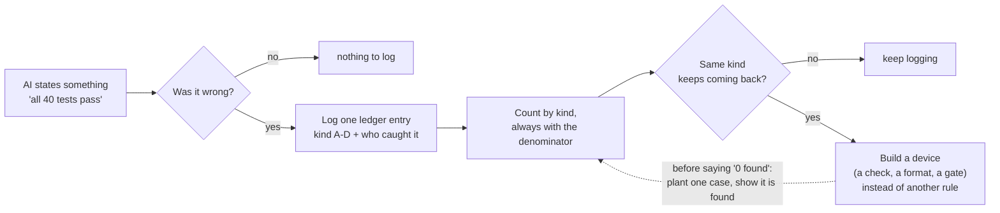
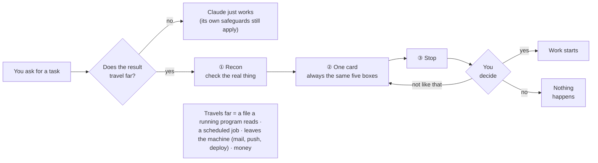

# collab-os

**How to catch your AI when it says something wrong.**

*[한국어](README.ko.md)*

This is for people who already use Claude Code, Anthropic's terminal assistant. If you do not have it yet, install it and sign in first - Claude Code's own documentation is at code.claude.com/docs - then come back here.

AI assistants are now good enough that most of their mistakes are not obvious. They do not say nonsense; they say "all 40 tests pass", "that file isn't used anywhere", "I've updated both copies" - fluently, plausibly, and sometimes wrongly. If you work with one every day, the expensive errors are the confident ones.

collab-os is one person's record of those errors, kept for nine weeks, plus the smallest set of tools that made keeping it possible (built around Claude Code). It is not a framework. All of it rests on one idea:

> **Do not trust a claim the system has not shown it can check.**

## In three lines

- **The problem:** an AI assistant states wrong things with full confidence, and acts on irreversible things without asking.
- **What this is:** nine weeks of one person's ledger - 230 wrong claims an AI assistant made, each logged after the fact with who caught it - plus the smallest set of tools that made the logging possible (a charter, a launch gate, two checkers).
- **What it's not:** a rule file you hope the AI reads. Each piece either makes a skipped step visible, counts the error, or tests the tester first.



A template is text you hope the AI reads. This kit does not assume it will: it makes the skipped step visible, counts the miss, tests its own checkers - and it comes with nine weeks of counts.

Start with the cases ([`CASES.md`](CASES.md)) -> the ledger template ([`ledger/LEDGER-TEMPLATE.md`](ledger/LEDGER-TEMPLATE.md)) -> then the quickstart ([`QUICKSTART.md`](QUICKSTART.md)).

## Install with Claude Code (paste this)

Tested on macOS with Claude Code 2.1.296. On Linux only the hook and the tools were checked (installing Claude Code there was not tested). Windows is untested: the session-start hook is a POSIX shell script, and on Windows Claude Code runs shell-form command hooks through Git Bash (Git for Windows) - without it they go to PowerShell, which cannot run this script. WSL has not been tried.

**Easiest:** open Claude Code in the unzipped folder and type one line - `Read INSTALL.md in this folder and follow it step by step.` ([`INSTALL.md`](INSTALL.md) is the prompt below as a file, byte for byte; the pasted block is the path outside testers have used.)

Or paste it yourself: unzip the archive (or clone the repository), open Claude Code in that folder or the folder directly above it, and paste this whole block into the chat:

<details>
<summary>The install prompt - click to expand, then copy the whole block</summary>

````text
Install the collab-os plugin for me from the folder I unzipped. Do the steps below in order and report the result of each step in one line.

Rules for this whole task:
- Write nothing outside: the collab-os folder, ~/.config/collab-os/, and what the `claude plugin` commands write on their own: ~/.claude/plugins/, the extraKnownMarketplaces and enabledPlugins entries in ~/.claude/settings.json, and Claude Code's own state file ~/.claude.json (plus its backup under ~/.claude/backups/). Do not edit Claude Code's own files (settings.json, .claude.json) yourself.
- No rm, no sudo, never overwrite an existing file, no network requests.
- If anything is unclear or a step fails, stop and ask me. Do not guess.

1. Find the absolute path of the unzipped collab-os folder: look in the current folder, its subfolders and its parent folders for plugin/.claude-plugin/marketplace.json, open each one you find and keep only those whose "name" is exactly collab-os. The folder that contains that plugin folder is the collab-os folder, whatever it is called - collab-os, collab-os-main (GitHub's Download ZIP) or a name your unzip tool shortened, such as collab-os-v0. The current folder may itself be that folder. If you do not find exactly one, ask me for the path and stop.
2. Run `claude plugin marketplace list`. If a marketplace named collab-os is already listed and points at this same folder, just continue. If it points somewhere else, show me both paths and ask whether to replace it; continue only if I say yes, by running `claude plugin marketplace remove collab-os` - tell me first that this also uninstalls the plugin that came from it and deletes its saved options, secrets and data. In either case, then run `claude plugin marketplace add <that absolute path>/plugin`, then `claude plugin install collab-os@collab-os`, then `claude plugin list`. If the list does not show collab-os@collab-os with Status: ✔ enabled, show me the output exactly as printed and stop.
3. If ~/.config/collab-os/CHARTER.md already exists, do not change it: ask me what to do and stop. Otherwise run `mkdir -p ~/.config/collab-os` and create ~/.config/collab-os/CHARTER.md containing exactly the text between BEGIN and END:
BEGIN
# My charter

## I2. Reality is the source of truth
The actual state beats documents, memory and guesses - meaning what the running
code path really reads. If you cannot check, do not assert.

## I3. No completion without verification
"Done" only after running and checking the real thing. Irreversible or structural
changes get a second pair of eyes that did not share the context that produced them.

## I4. Irreversible things belong to the human
Anything whose effect reaches people, money, live services or running systems
happens only after my approval. Without approval, the default is "don't".
Editing a file that a running process reads is a deployment.

## I8. Start from purpose
Decide what "finished" means before choosing a tool or a method. Purpose is the
reference point for the whole task: changing track is allowed, drifting without
knowing is not - a change of track is a declared decision. Finished means the
purpose is met, not that an artifact exists.
END
4. Tell me: "Quit this session and run claude again. In that new session ask: what did the collab-os hook tell you? The assistant should answer with the location of your charter."
5. Suggest one example task for trying the gate in that new session - for example `/collab-os:gate set up a nightly job that emails me a disk-usage report` - and stop. Do not carry out that task.
````

</details>

Everything this prompt does is the same as "Do it by hand" below (the QUICKSTART has the step-by-step version) - read it first, and if you would rather not hand it to the assistant, do it by hand.

One outside tester reported that v0.1.4 installed on a new Mac and reinstalled on an existing Mac without problems, using this paste-in prompt (step 1 remarked once that the folder name did not match - the wording above now allows other names; an earlier version stalled once at step 2; that is fixed). How long it takes has not been timed yet - if it stalls, tell us where.

## Measured

| | |
|---|---|
| Period | One user's claim-error ledger, 2026-08-21 -> 2026-10-23 (63 days - nine weeks; counted 2026-10-23 10:24 with `tools/ledger_count.py claims --profile private` plus one `--alias` that maps the user's own name to `human`) |
| Wrong claims logged | 230 numbered entries (a suffixed number such as 12b counts as its own entry) - class A 32 · B 60 · C 100 · D 38 (A quoted instead of measured · B broken measurement · C partial lookup, total claim · D other - definitions in `ledger/LEDGER-TEMPLATE.md`) |
| Definition of "entry" | A dated heading with a number and a class. Suffixed numbers (12b, 161-a) are separate entries; headings marked candidate or withdrawn are excluded; plain numbers only would give 216. Unnumbered headings (4) are not counted |
| Who caught them | Each entry's detector field, matched against the four words in `ledger/CODEBOOK.md` section 3a: the assistant itself 102 (44%) · independent review by a second model 75 (33%) · a person 22 (10%) · runtime measurement 14 (6%) · unclassifiable 17 (7%) - sums to 230 |
| Before the ledger existed | 21 retroactively collected cases: the assistant itself caught 4 of 21. **Not comparable with the row above**: these were pulled afterwards from change and decision records that happened to mention them, so the whole retroactive set is under-counted; self-caught cases may have been missed more often (not measured), and the ledger's own rule ("log your own wrong claim at once") is what creates the self-caught category |
| Second-model cross-checks | 47 independent cross-checks of decision cards, code and documents by a second model, 2026-09-30 -> 2026-10-23 (the log has 51 rows; 4 that were not completed cross-checks - one never run, one never sent, one advice request, one reading later ruled invalid - are not counted); findings rejected after re-verification: 1 recorded as of 2026-10-23 |

**These are counts, not a controlled experiment, and the rows are not a before/after comparison.** The ledger changes what gets noticed and what gets recorded, as well as what gets caught; nothing here shows that the ledger made the assistant catch more of its own errors.

## Why this is different

**Machine-side claim checking exists.** Tools such as `lc198707/anti-lie` (which describes itself as an "LLM Claim Auditing Layer"), and similar projects, have a machine judge a claim at the moment it is produced. They audit a claim when it is made.

**Action gates exist.** Hooks and gates that stop irreversible actions exist too - for example `Myr-Aya/GouvernAI-claude-code-plugin` (runtime guardrails for Claude Code), and a growing number of governance hooks for Claude Code. The `/collab-os:gate` command in this repository belongs to that same category; it is the first thing to try in the quickstart, not the point of the project.

**What we could not find** is a ledger kept *after* the fact - the assistant writes every entry, whoever caught the error - with the detector classified for each entry (the assistant itself / a second model / the human / runtime measurement), a negative control before any "zero", and nine weeks of counts published. On 2026-10-13 we looked at seven neighbouring projects on GitHub (claim auditors, governance hooks, human-in-the-loop gates); six were found, one was not. None of the six had all of these together: none classified the detector, two had a negative control, and of the five whose ledgers we could check none kept an after-the-fact ledger (one was not checked). If you know one, please open an issue.

The difference is not a smarter checker. It is the record.

## What is inside

| Piece | What it is | Start here |
|---|---|---|
| Cases | Short, anonymised stories of what these pieces actually caught | [`CASES.md`](CASES.md) |
| Claim-error ledger | A format for recording the claims your assistant got wrong, by kind (A-D), with the **negative control** rule (here: a control for the claim "zero" - a planted positive that the same command must find) | [`ledger/LEDGER-TEMPLATE.md`](ledger/LEDGER-TEMPLATE.md) |
| Root-cause codebook | Ten root causes (R1-R10) and a decision order, so two independent classifiers can agree on *why* | [`ledger/CODEBOOK.md`](ledger/CODEBOOK.md) |
| Tools | `tools/claim_scan.py` - a thermometer for "does it state the scope when it states a number?"; `tools/rule_health.py` - dead pointers, numbering gaps and rule-count drift; `tools/_config.py` - one place that knows your paths; `tools/ledger_count.py` - counts the ledger, the gate log and the cases by class and detector, always with the denominator; `tools/negative_control.py` - plants a known case in a temporary copy before you report "0 found" | [`tools/`](tools/) |
| Charter template | Ten articles - each with the failure it exists to prevent | [`CHARTER-TEMPLATE.md`](CHARTER-TEMPLATE.md) |
| Plugin for Claude Code | `/collab-os:gate` (decision card before risky work), `/collab-os:recon` (check reality before asserting), `/collab-os:handoff` (move work between sessions or models without losing the plot), plus a session-start hook | [`plugin/collab-os/README.md`](plugin/collab-os/README.md) |
| Quickstart | Four principles and one command, about 15 minutes to the first gate | [`QUICKSTART.md`](QUICKSTART.md) |
| Publishing tools | The allowlist exporter and word-floor leak scanner this repository is itself published with | [`export/`](export/) |

## The four ideas that carry everything

1. **Reality is the source of truth.** A count copied from a README is a quote, not a measurement. "Real" means what the running code path actually reads - not the file that looks right.
2. **No completion without verification.** "Done" means it was run and checked. Changes that are hard to undo, or that change the structure, get a second pair of eyes that did not share the context that produced them.
3. **Irreversible things belong to the human.** Anything that reaches people, money or running systems waits for approval. Without approval, the default is "don't".
4. **Start from purpose.** Decide what "finished" means before choosing a tool or a method. Changing track is allowed; drifting without knowing is not - a change of track is a declared decision.

The other six articles in the charter - outputs as files, the human's understanding as the bottleneck, quality floor versus cheapest path, refinement over accumulation, humans make the rules, and "finished means it changed something" - grow out of these four. The starter charter the installer writes has these four; the template `CHARTER-TEMPLATE.md` has all ten.

## Why a ledger of wrong claims?

Most safety nets protect artifacts: tests, linters, type checkers. Almost nothing protects the assistant's *sentences*, and those sentences are what you make decisions on. Writing down each wrong claim, by kind, turns "it keeps doing that" into a count - and a count tells you when to stop adding rules and build a device instead.

The single most useful rule in the ledger is the **negative control**: before anyone reports "0 found", they show that the same command finds one planted case. A search that cannot find a planted needle has not shown the haystack is empty.

## Install

You need Claude Code, installed and **logged in** (run `claude` once and sign in before you start).

1. **Easiest:** open Claude Code in the unzipped folder and type `Read INSTALL.md in this folder and follow it step by step.` - or paste the prompt from [Install with Claude Code](#install-with-claude-code-paste-this) at the top of this page into Claude Code.
2. **Check** - see below.
3. **Or do it by hand** ([`QUICKSTART.md`](QUICKSTART.md) has every step). Unzip the archive (or clone this repository - the green Code button on GitHub shows the URL - into a folder named `collab-os`), go into the folder with `cd collab-os` (the unzipped folder may be called something else - `collab-os-main` from GitHub's Download ZIP, or a shortened name such as `collab-os-v0`; use the name you see), then:

```
claude plugin marketplace add ./plugin
claude plugin install collab-os@collab-os
```

(From the folder *above* it, the first command is `claude plugin marketplace add ./<folder name>/plugin` - for example `./collab-os/plugin` or `./collab-os-main/plugin`.)

**Did it install? Check in ten seconds** - in a terminal, run `claude plugin list`:
- Success: the list shows `collab-os@collab-os` with `Status: ✔ enabled`.
- `` No plugins installed. Use `claude plugin install` to install a plugin. `` - the install step did not run.
- `✘ Path does not exist: .../collab-os/plugin` (printed by the marketplace step) - you ran it from the wrong folder; run it from inside the unzipped folder (or use `./<folder name>/plugin` from the folder above).
- `✘ Failed to install plugin "collab-os@collab-os": Plugin "collab-os" not found in marketplace "collab-os".` - the marketplace step was skipped or failed; run it first.

Then put a charter at `~/.config/collab-os/CHARTER.md` (or create `~/.config/collab-os/config.json` pointing at yours - for its contents see [`collab-os.config.example.json`](collab-os.config.example.json)). For the hook message in Korean, put `"lang": "ko"` in the config. The four-article starter charter is in QUICKSTART Step 3 as one paste-in command; the ten-article template is `CHARTER-TEMPLATE.md`. Then start Claude Code afresh (quit the current session and run `claude` again): the session-start hook announces where your charter is.

The Python tools need Python 3.9 or newer and nothing else.

## You do not need the slash command most of the time

The three procedures are **skills**. Claude Code shows the model each skill's one-paragraph description, and the model is meant to call the skill itself when a task matches it - a new asset, a multi-step job, anything that touches something running. So in daily use you just ask for the work. If the task is risky, a decision card should appear before anything happens, without you typing a command.

`/collab-os:gate <task>` is the manual button. Use it to check that the gate works in your setup, or to force a card when you want one.

The gate card is always the same five boxes in the same order - that is the format the gate skill specifies. One tester (one person so far) said this was what they liked about it: the "things to decide" they usually get at the end of a task does not come as a table, while the card is always the same table.

**Unmeasured:** how often the gate fires on its own outside the author's machine. Tester reports are being collected - cards issued without the command, risky tasks that went ahead without a card, and cards on tasks that did not need one. When there are numbers, this line changes. If you have tried it, tell us.

## How this differs from Claude Code's own safeguards

Claude Code has safeguards of its own: it asks before running a command, and one tester saw it stop a dangerous command right before it ran - some of this, that tester reports, still fires in auto-approve mode. Those safeguards work **per command, right before execution**. As the tester put it, deleting a local file is already caught. The gate is not for that.

The gate works **per task: once, before the work starts**, and asks "what does this touch, and how do we undo it?". In the tester's words, it is for work where **the command looks harmless but the result travels far**:

1. A one-line edit to a file that a running program reads - the edit is the deployment.
2. Registering a scheduled job - the effect arrives tomorrow, not now.
3. Anything that leaves the machine - mail, `git push`, a deploy.
4. Anything that costs money - API calls, paid services.

If a built-in safeguard already catches it, it is not a gate case.



<details>
<summary>A real card - actual output, lightly edited (click to expand)</summary>

Produced on 2026-10-23 by `/collab-os:gate add a nightly job that emails me a disk-usage report`, run once in a throwaway project (two files, no charter installed) with Claude Code 2.1.296 and the plugin loaded for that session only; write tools were disabled, so the stop was also enforced from outside. Edits: home paths, the mail address, one private folder name and four job names were generalised. Nothing else was changed, including the open questions. (Claude Code CLI version 2.1.296 was read from the same binary the same day, after the run.)

**Recon result**

- **Charter not loaded.** `~/.config/collab-os/CHARTER.md` doesn't exist, so this is the reduced card. I'm not asserting anything on the strength of the rules.
- **This repo** (`gate-sample`) has only `README.md` and `scripts/backup.sh`.
  - `backup.sh` is a stub that just runs `echo backup`.
  - The README says it "runs nightly via launchd", but no plist in `~/Library/LaunchAgents` points at this repo. That claim isn't backed by anything running.
  - Nothing in the repo does disk usage or sends mail.
- **Scheduling on this machine:** about 45 launchd agents already exist in `~/Library/LaunchAgents`.
  - The convention is `com.user.<name>.plist`, with a `StartCalendarInterval`, a log file, and a wrapper in `~/jobs/bin/`.
  - `com.user.mem-monitor` is the closest existing job. It's a system monitor, but I haven't read its contents.
  - `com.user.weekly-mail` is a mailing job. It sets recipients through an env var (`MAIL_TO`) and I haven't looked at how it sends.
  - There is no existing disk-usage job. A new one would overlap with `mem-monitor` and `health-watchdog`, which I haven't read.
- **Mail path:** I haven't found how the existing jobs send mail (SMTP, `mail`, or a Python helper). That's the main open question. The Gmail connector can only create drafts or send as you from this session. It isn't something a nightly launchd job can use.
- **Not checked:** `crontab -l`, because I have no shell tool in this session.

**Gate card**

| Box | What goes in |
|---|---|
| 1. Purpose | You get a nightly disk-usage report in your inbox. That way you notice a filling disk before it breaks the other jobs, not just have a script that exists. |
| 2. Output | A change to a running system: a new launchd agent (`com.user.disk-report.plist`) plus a report script that emails `you@example.com`. It's recurring and it leaves the machine. |
| 3. Horizon | Recurring, nightly and open-ended. It runs until someone removes it. |
| 4. Where to do it | Claude Code in a local terminal: the work needs `~/Library/LaunchAgents` and a way to run and test the mail path. Open question: put the script in this repo's `scripts/`, or alongside the existing jobs in `~/jobs/`? I lean toward `~/jobs/`, since that's where the other jobs live. Please confirm. |
| 5. Sources to load | Charter: not loaded. `mem-monitor` (plist and `mem_monitor.sh`) and `health-watchdog` to check for overlap. The mail sender used by `weekly-mail` and the `bin/weekly-mail` wrapper. This repo's `README.md` and `backup.sh`. |

**Rollback:** run `launchctl bootout gui/$(id -u)/com.user.disk-report`, then delete the plist and the script. Mail already sent can't be recalled.

**Decisions for you before I start:**
1. **Mail mechanism.** Reuse the one `weekly-mail` uses, if it's suitable. Otherwise tell me what you'd rather use.
2. **Send time.** For example 07:30, away from the existing 08:45 jobs.
3. **Report contents.** I'd default to `df -h` plus the top 10 largest directories under `~`. Tell me if you want different volumes or a threshold alert.
4. **Order of work.** I'd write and dry-run the script first, printing to stdout with nothing sent. Then I'd send one test mail, and only then register the launchd job. That puts the part that touches nothing running first.

I'll wait for your confirmation before doing any of it.

</details>

## Honest limits

- **The plugin enforces nothing.** It announces where your charter is and gives you procedures; the model still has to follow them. The value is in making skipped steps visible, not impossible. The publishing tools in `export/` are the one exception: they refuse to promote a tree that fails the leak check.
- **Auto-firing is unmeasured outside the author's machine.** The procedures are skills the model is meant to call on its own; whether it does so in your setup is not measured yet; tester reports are being collected (see "You do not need the slash command most of the time").
- **Claude Code only** for the plugin. Other surfaces need the charter delivered another way.
- **The tools measure habits and structure, not truth.** `claim_scan` can tell you that a number came without a scope; it cannot tell you the number is wrong. `rule_health` can tell you that a rule count changed; it cannot tell you whether the change was approved.
- **Built and used by one person.** It reflects one way of working. Take the parts that fit.

## Status

v0.1.4 - first public draft (plugin 0.1.4). Feedback, especially "I tried the quickstart and step N did not match what I saw", is the most useful thing you can send.

## License

Code under MIT ([`LICENSE`](LICENSE)); documentation under CC BY 4.0 ([`LICENSE-docs`](LICENSE-docs)). In the plugin, the manifests and the hook script are MIT; the skill text is CC BY 4.0. Outside references are listed in [`THIRD-PARTY.md`](THIRD-PARTY.md).
